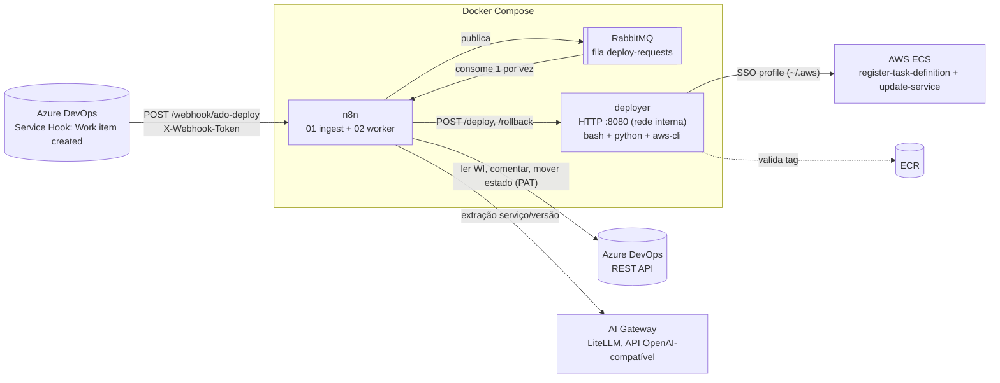
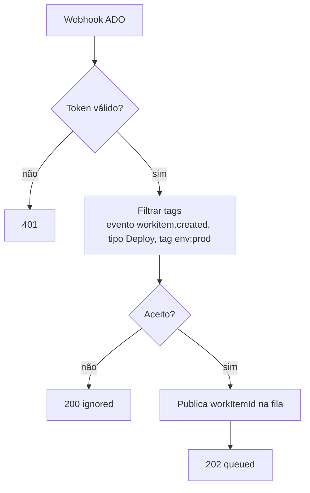
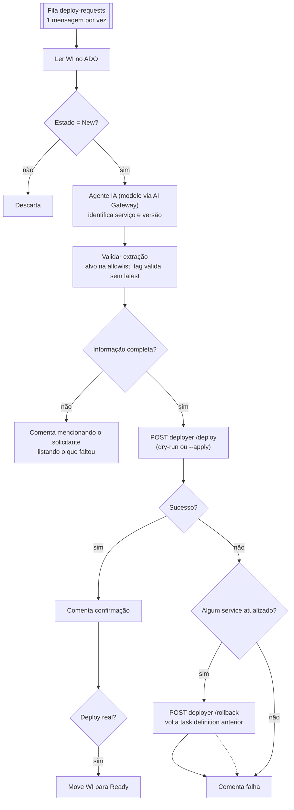

# n8n-deploy-sre

Demo de automação de deploy em produção (AWS ECS) orquestrada pelo n8n: um webhook do Azure DevOps enfileira work items de deploy, um worker com agente de IA interpreta o WI (serviço e versão), executa o deploy e, em caso de erro, faz rollback para a imagem anterior.

## Arquitetura



## Workflow 01: ingest (webhook para fila)



Tipo do WI e tag obrigatória são configuráveis por `WORKITEM_TYPE` e `REQUIRED_TAG`.

## Workflow 02: worker (agente de IA + deploy + rollback)



- O agente (nó AI Agent com Structured Output Parser) devolve JSON estruturado (`target`, `service`, `version`, `missing`). O código valida o resultado independentemente do LLM: o alvo precisa estar na allowlist do nó **Preparar dados**, a tag precisa casar com `^[A-Za-z0-9][A-Za-z0-9._-]{0,63}$` e `latest` é rejeitado. O deployer valida de novo.
- Se faltar serviço ou versão, o WI recebe um comentário com menção ao solicitante (`System.CreatedBy`) e nada é executado.
- Rollback: o `deploy-ecs.sh` guarda a task definition anterior de cada service atualizado; em falha (inclusive timeout de estabilização) o worker chama `/rollback`. Estado antigo é limpo a cada `--apply`, e serviços ainda não tocados são ignorados no rollback.
- Mensagens são consumidas uma por vez (`parallelMessages=1`), então dois deploys nunca rodam em paralelo.

## Uso

```bash
cp .env.example .env                              # ADO_PAT, ADO_ORG_URL, ADO_PROJECT, WEBHOOK_TOKEN, AWS_DIR
cp scripts/targets.example.conf targets.conf      # contas, clusters e services
aws sso login --profile prod
docker compose up -d --build

cp credentials/llm-gateway.example.json credentials/llm-gateway.json   # preencha apiKey (virtual key) e url do gateway
docker exec n8n-deploy-demo n8n import:credentials --input=/credentials/rabbitmq.json
docker exec n8n-deploy-demo n8n import:credentials --input=/credentials/llm-gateway.json
docker exec n8n-deploy-demo n8n import:workflow --separate --input=/workflows
```

1. Abra http://localhost:5678 e crie o usuário owner.
2. O modelo do agente é o nó **Modelo LLM** (credencial `AI Gateway`, modelo em `LLM_MODEL`). Use um modelo que a sua chave enxergue no gateway (`GET /v1/models`); alguns modelos rejeitam `temperature`, por isso o parâmetro não é enviado.
3. Publique os dois workflows (botão Publish ou `n8n publish:workflow --id=<id>`).
4. No Azure DevOps: Project Settings, Service hooks, Web Hooks, evento **Work item created**, URL `https://<host-público>/webhook/ado-deploy` e header `X-Webhook-Token: <WEBHOOK_TOKEN>`. Para teste local, exponha a porta 5678 com um túnel e defina `PUBLIC_URL`.
5. O WI precisa ter a tag `env:prod` e, na descrição, o serviço e a versão a publicar.

Teste manual do ingest:

```bash
curl -X POST http://localhost:5678/webhook/ado-deploy \
  -H 'Content-Type: application/json' -H "X-Webhook-Token: $WEBHOOK_TOKEN" \
  -d '{"eventType":"workitem.created","resource":{"id":123,"fields":{"System.WorkItemType":"Deploy","System.Tags":"env:prod"}}}'
```

Notas de segurança:

- `dryRun=true` é o padrão no nó **Config** do worker: só mostra o diff de imagem e comenta o WI. Para aplicar em produção, mude para `false`; o deploy roda sem confirmação humana dentro do n8n.
- O PAT do Azure DevOps precisa de leitura e escrita em work items; prefira um usuário de sistema.
- A porta do deployer não é publicada; só o n8n a alcança pela rede do compose. As credenciais do RabbitMQ no repositório valem apenas para essa rede local.

## Estrutura

| Caminho | Descrição |
|---|---|
| `docker-compose.yml` | n8n, RabbitMQ e deployer |
| `workflows/01-ado-webhook-ingest.json` | Webhook, filtro de tags e publicação na fila |
| `workflows/02-deploy-worker.json` | Worker: agente IA, deploy, rollback, comentário e mudança de estado |
| `deployer/` | Servidor HTTP mínimo (`/deploy`, `/rollback`) que chama o script |
| `scripts/deploy-ecs.sh` | Troca a tag da imagem na task definition e faz `update-service` (dry-run por padrão) |
| `scripts/targets.example.conf` | Exemplo de alvos (conta, região, cluster, services) |
| `rabbitmq/` | Definição da fila, usuário e vhost |
| `credentials/rabbitmq.json` | Credencial local do RabbitMQ para `import:credentials` |
| `credentials/llm-gateway.example.json` | Modelo da credencial do AI Gateway (o arquivo real `llm-gateway.json` fica fora do git) |

## Releases

Versionamento com [semantic-release](https://semantic-release.gitbook.io) a cada push em `main`, a partir de [Conventional Commits](https://www.conventionalcommits.org) (`feat:` minor, `fix:` patch, `feat!:` major).
