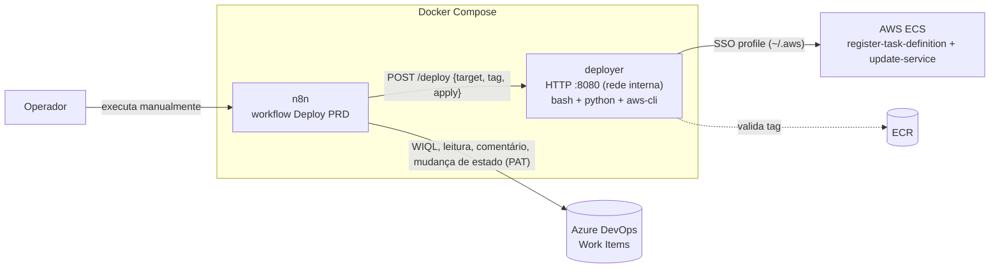
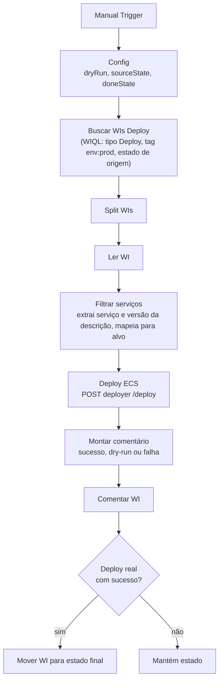

# n8n-deploy-sre

Demo de automação de deploy em produção (AWS ECS) orquestrada pelo n8n a partir de work items do Azure DevOps.

Stack local via Docker Compose: **n8n** (orquestra o fluxo) + **deployer** (sidecar com `aws-cli` que executa `scripts/deploy-ecs.sh`).

## Arquitetura



## Fluxo do workflow



O WI de deploy deve ter na descrição (Markdown) as linhas `**Serviço**: <nome>` e `**Versão da imagem**: <tag>`. O mapeamento serviço para alvo fica no nó **Filtrar serviços**.

## Uso

```bash
cp .env.example .env              # ADO_PAT, ADO_ORG_URL, ADO_PROJECT, ADO_AREA_PATH, AWS_DIR
cp scripts/targets.example.conf targets.conf   # ajuste contas, clusters e services
aws sso login --profile prod
docker compose up -d --build
docker exec n8n-deploy-demo n8n import:workflow --input=/workflows/deploy-prd-sre.json
```

Abra http://localhost:5678, crie o usuário owner e execute o workflow manualmente.

- O PAT do Azure DevOps precisa de leitura e escrita em work items.
- `dryRun=true` (padrão no nó Config) apenas mostra o diff de imagem e comenta o WI. Para aplicar de verdade, mude para `false`: o deploy roda sem confirmação manual dentro do n8n.
- O estado anterior da task definition fica no volume `deploy_state` para rollback (`scripts/deploy-ecs.sh rollback <alvo>` dentro do deployer).

## Estrutura

| Caminho | Descrição |
|---|---|
| `docker-compose.yml` | n8n + deployer |
| `deployer/` | Servidor HTTP mínimo que chama o script de deploy |
| `scripts/deploy-ecs.sh` | Troca a tag da imagem na task definition e faz `update-service` (dry-run por padrão) |
| `scripts/targets.example.conf` | Exemplo de alvos (conta, região, cluster, services) |
| `workflows/deploy-prd-sre.json` | Workflow n8n |

## Releases

Versionamento com [semantic-release](https://semantic-release.gitbook.io) a cada push em `main`, a partir de [Conventional Commits](https://www.conventionalcommits.org) (`feat:` minor, `fix:` patch, `feat!:` major).
